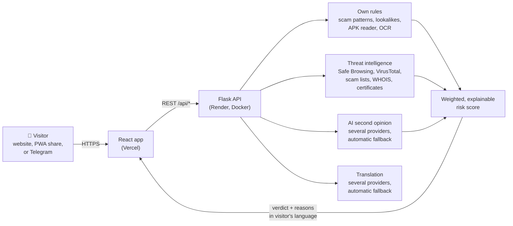

# TrustLight

**A light you can trust. A scam checker for everyday people in India.**

TrustLight checks whether a link, message, screenshot, QR code, file, phone number, UPI ID, email or password is safe, and explains the answer in plain language in **English, Hindi, Kannada and Tulu**. It is built for people who are new to smartphones (village families, elders, first-time UPI users) who are the main targets of fake KYC messages, fake bank calls, QR "receive money" tricks and fake government apps.

No sign-up. No app store. History stays on your own phone.

🔗 **Use it:** [trustlight-app.vercel.app](https://trustlight-app.vercel.app)

---

## Contents

- [Why TrustLight](#why-trustlight)
- [Features](#features)
- [How it works](#how-it-works)
- [How each check works](#how-each-check-works)
- [AI, and how it is kept safe](#ai-and-how-it-is-kept-safe)
- [Accuracy](#accuracy)
- [Privacy and security](#privacy-and-security)
- [Tech stack](#tech-stack)
- [Project structure](#project-structure)
- [Running locally](#running-locally)
- [Configuration](#configuration)
- [Deployment](#deployment)
- [Testing and automation](#testing-and-automation)
- [Languages](#languages)
- [API reference](#api-reference)
- [Contributing, security reports and license](#contributing-security-reports-and-license)

---

## Why TrustLight

Most online fraud in India does not need hacking skills. It needs one believable message: "your account will be blocked today, update KYC", "scan this QR to receive ₹5,000", "install this app for your subsidy". Security tools exist, but they speak English and technical language.

TrustLight is designed around three ideas:

1. **Check before you trust.** Every kind of thing a scammer sends can be checked in one place.
2. **Explain, don't just judge.** Every verdict shows *why*, point by point, in the visitor's language.
3. **Meet people where they are.** Share a suspicious message straight from WhatsApp into TrustLight, in Kannada or Tulu, without creating an account.

---

## Features

| | Feature | What it does |
|---|---|---|
| 🔗 | **Link checker** | Checks a web address against Google Safe Browsing, VirusTotal (70+ security companies) and several live scam lists, then looks at website age, certificate, lookalike names of 118 Indian and global brands, and what the page actually asks for |
| 💬 | **Message checker** | Finds scam tricks (KYC, blocked account, prize, urgency, OTP or PIN requests, pay-first) in English, Hinglish, Kannada, Hindi and more, checks every link inside, and explains "what this message says" in the visitor's language |
| 🖼️ | **Screenshot checker** | Reads text from a WhatsApp or SMS screenshot with OCR (Kannada, Hindi, English), then runs the full message check, including any QR code in the picture |
| 📱 | **QR code checker** | Reads the QR and shows where it really goes: a link gets the full link check, a UPI payment shows who gets the money, how much and why ("scanning only sends money, it never receives it") |
| 📄 | **File / APK checker** | Checks the file's fingerprint (SHA-256) on VirusTotal, finds the real file type behind a fake name, flags double extensions and macros, and reads an Android APK's permissions (SMS, Accessibility, notifications) without installing it |
| 📞 | **Number / UPI ID checker** | Combines what the number or ID shows (foreign codes, personal numbers posing as banks, "refund" UPI IDs), what the caller asked for, and fixed rules (bank calls come from 1600 numbers, 1930 is the cyber-crime helpline) |
| ✉️ | **Email checker** | Reads SPF / DKIM / DMARC results, reply-to traps, lookalike and throwaway sender domains, and hidden links behind "Click here" buttons |
| 🔒 | **Password checker** | Rates strength and checks if the password appeared in a data breach using Have I Been Pwned's k-anonymity range search |
| 🌐 | **Network checker** | Shows if the connection looks like a VPN, proxy or data centre, and if the page is on HTTPS |
| 🤖 | **Ask AI** | A safety assistant that answers questions in any language and spelling, with a "Write to the TrustLight team" option for a real person |
| 🆘 | **"I clicked a scam / lost money"** | A step-by-step recovery plan with the 1930 helpline and cybercrime.gov.in shortcuts |
| 📚 | **Scam library** | Searchable guide to common scams (KYC, fake refunds, job offers, fake apps, digital arrest) |
| 📊 | **Safety dashboard** | A personal safety score built from recent checks, stored only on the device |
| 📲 | **Install as an app (PWA)** | Add to the home screen and use **Share → TrustLight** from WhatsApp, SMS, Gallery or Files |
| 🤖 | **Telegram bot** (optional) | Forward a message, link, photo or file to the bot and get the same check in a short reply |

---

## How it works

1. The phone sends what to check to the backend. API keys never reach the phone.
2. Slow work (outside services, link checks, AI, translation) starts **in parallel** on worker pools, while TrustLight's own rules run at the same time.
3. Every outside call has a **timeout**, results are **cached** (in memory, and in a small Redis store that survives restarts), and a **quota manager** keeps each service within its daily limits. If one service is slow or down, the others still answer.
4. All findings become one **weighted score** with a point-by-point breakdown: **Safe**, **Suspicious** or **Dangerous**.

---

## How each check works

<b>Link checker</b>

1. **Clean up the input:** pull the address out of a whole pasted message, add `https://` if missing, unwrap redirect links (`google.com/url?q=...`), follow short links.
2. **Find the real owner:** the registered domain decides who owns a link (`sbi.kyc-update.top` belongs to `kyc-update.top`, not SBI).
3. **Ask many sources at once:** Google Safe Browsing, VirusTotal, OpenPhish, URLhaus, Phishing Army, Phishing.Database, PhishStats, abuse.ch ThreatFox, AlienVault OTX, urlscan.io, AbuseIPDB, plus RDAP/WHOIS (website age), the TLS certificate and crt.sh (certificate history), and the Tranco top-sites list (popularity).
4. **Brand impersonation:** compare against a book of **118 brands and 261 official domains** (banks, UPI apps, shopping, government, electricity boards). Catches brand names in the wrong domain, misspellings (`amazom.in`, edit distance), lookalike letters (`rn` → `m`, `l` → `i`), foreign-alphabet homoglyphs (punycode skeletons) and brands hidden in the path. Real country sites (`google.de`) and company-run services are not blamed.
5. **Look at the page itself:** password boxes, redirects to other sites, cheap or risky domain endings, scam words in the name.
6. **Score:** each finding adds points; the total gives the verdict with plain reasons.

<b>Message and screenshot checker</b>

1. Check the input really is a message (a lone link or number is sent to the right tool).
2. Start translation and every link check in the background.
3. TrustLight's rules read the text: KYC and block threats, prizes, urgency, OTP / PIN / CVV requests, pay-first, remote-access apps, disguised spellings (`0TP`, `K.Y.C`), and mixed alphabets. Genuine bank alerts ("do not share", "Not you? call 1800...") are recognised so real OTP messages are not called scams.
4. Sender checks (bank-style sender IDs, foreign numbers) and names from the RBI list of unauthorised entities.
5. A masked AI second opinion (see below).
6. Screenshots are read with Tesseract OCR first (Kannada, Hindi, English, with a backup OCR service for poor readings); broken links across lines are joined and common OCR mistakes fixed.

<b>QR code checker</b>

The image is decoded with zbar and OpenCV, retrying on cleaned-up versions (enlarged, shrunk, high-contrast, inverted for dark mode). The content is then routed:

- **Link** → the full link check.
- **UPI payment** (`upi://pay`) → payee UPI ID, name, amount and note are checked (scam words such as "refund" or "receive", invalid IDs, community reports).
- **Text** → hidden links get the link check; the rest gets the message rules. Wi-Fi and contact cards are recognised as harmless.

<b>File and APK checker</b>

Files are never run or opened. TrustLight computes the SHA-256 fingerprint and looks it up on VirusTotal, reads the real file type from its first bytes (so `invoice.pdf.exe` or a renamed APK is caught), flags macro-enabled documents and risky archives (with zip-bomb limits), and reads an APK's `AndroidManifest.xml` with a small built-in binary XML parser to list dangerous permissions such as reading SMS (OTP theft) or Accessibility (screen takeover).

<b>Email checker</b>

Works from a simple form (sender, subject, message) or the full "Show original" source.

- **Who really sent it:** SPF, DKIM and DMARC results; Reply-To pointing somewhere else; display name claiming a bank while the address is a free mailbox; lookalike domains.
- **Sender domain health (DNS):** does it exist, can it receive mail, is it a throwaway address, how old is it, is it on a scam list.
- **Content:** the same rules as the message checker (with translation for Indian languages), foreign numbers, RBI-listed names.
- **Links:** taken from the text and the HTML, so links hidden behind buttons are checked too.
- **Fairness:** mild wording counts half; a genuine company email that passes DMARC from its own domain is not punished for "secure your account" wording.

<b>Number / UPI ID, password and network checkers</b>

- **Number / UPI ID:** works without any outside service. It combines what the number shows, what the caller asked for, and rules that hold for everyone, and always points to the government's own "Report and Check Suspect" search.
- **Password:** strength rules plus Have I Been Pwned k-anonymity: only the first 5 characters of the SHA-1 hash are sent, and the match is done on the server.
- **Network:** browsers do not expose Wi-Fi details, so TrustLight checks what can honestly be checked: whether the public IP belongs to a VPN, proxy or hosting provider, and whether the connection is HTTPS.

---

## AI, and how it is kept safe

TrustLight uses AI in two places, with strict limits.

**1. Second opinion on messages**
- Tried in order until one answers: Groq → Cloudflare Workers AI → Google Gemini → Mistral → NVIDIA.
- **The AI can only raise the risk, never lower it**, and only when it is confident. On its own it can make a message "Suspicious" but never "Likely scam"; that needs TrustLight's own rules to agree.
- Genuine bank alerts and OTP messages are protected from AI false alarms.
- Identical forwarded scams reuse the earlier verdict (only the verdict is stored, never the message).

**2. Ask AI assistant**
- Answers in the visitor's language and spelling, labelled as an automatic answer, with a real-person option.
- Told to stay on online safety, never ask for OTPs or passwords, never promise money back, and use only a fixed list of official contacts. Any other web address it writes is removed.
- Instructions hidden inside the visitor's text are ignored.

**Privacy for both:** phone numbers, account and card numbers, Aadhaar, OTPs, emails and UPI IDs are replaced with placeholders **before** any text leaves the server.

---

## Accuracy

A GitHub Actions workflow tests the **live** server every day with **real scam links reported that day** plus fixed samples for every checker. Results are saved in [`staysafe-full/accuracy/`](staysafe-full/accuracy/).

| Test | What is switched off | Live scam links | Caught | Detection |
|---|---|---|---|---|
| **Fair test** | TrustLight's own downloaded scam lists (the test links come from those lists, so using them would be cheating) | 88 | 83 | **94.3%** |
| **Blind test** | Every outside list and reputation service: only TrustLight's own analysis, as for a brand-new scam no list knows yet | 38 | 33 | **86.8%** |

*As of 15 October 2026, after 9 days. The sample is still small; the numbers update daily in [`summary.json`](staysafe-full/accuracy/summary.json).*

---

## Privacy and security

- **No accounts, no tracking.** Check history and the safety score live only in the browser's local storage.
- **Minimal storage on the server:** only verdicts about links, files, websites and apps, the AI verdict on a message, and translations of mass-forwarded messages (with personal details blanked). Keys are one-way SHA-256 fingerprints, nothing says who checked what, and entries expire.
- **Files are never executed.** Archives are read with size and ratio limits.
- **Personal details are masked** before any AI or translation call.
- **API keys stay on the server**, in environment variables, never in the frontend.
- **Hardening:** CORS allowlist, per-visitor and global rate limits (stricter for heavy checks), security headers and a Content-Security-Policy, input size limits, wrong-tool detection.
- **Continuous checks:** CodeQL code scanning and the full test suite run on every change.

Found a vulnerability? Please follow [SECURITY.md](SECURITY.md) and report it privately.

---

## Tech stack

| Layer | Technology |
|---|---|
| Frontend | React, TypeScript, Tailwind CSS, Vite, PWA (Web Share Target), hosted on Vercel |
| Backend | Python, Flask (one blueprint per feature), Docker, hosted on Render |
| Image reading | Tesseract OCR, zbar, OpenCV, Pillow |
| Threat intelligence | Google Safe Browsing, VirusTotal, OpenPhish, URLhaus, ThreatFox, Phishing Army, Phishing.Database, PhishStats, AlienVault OTX, urlscan.io, AbuseIPDB, Cloudflare URL Scanner, RDAP/WHOIS, crt.sh, Tranco, Have I Been Pwned |
| AI | Groq, Google Gemini, Cloudflare Workers AI, Mistral, NVIDIA, OpenRouter (with automatic fallback) |
| Translation | Google Cloud Translation, Gemini, Bhashini (Government of India), MyMemory, and built-in rules |
| Storage | Browser local storage (visitor), Upstash Redis over HTTPS (shared result cache) |
| Messaging | Telegram Bot API (scan bot and contact notifications), Resend (email) |
| CI / automation | GitHub Actions: tests and website build, CodeQL, daily live accuracy test, keep-alive ping |

---

## Project structure

    .
    ├── README.md, SECURITY.md, CONTRIBUTING.md, CHANGELOG.md, LICENSE
    ├── .github/workflows/
    │   ├── tests.yml            backend tests + website build on every change
    │   ├── codeql.yml           code security scanning
    │   ├── daily-accuracy.yml   daily test on the live server with real scam links
    │   └── keep-awake.yml       keeps the backend responsive
    └── staysafe-full/           (folder name kept from the project's first name, StaySafe)
        ├── accuracy/            daily accuracy results (summary.json, history.jsonl)
        ├── backend/             Flask API, see backend/README.md
        │   ├── app.py           app, blueprints, CORS, rate limits, security headers
        │   ├── Dockerfile       includes Tesseract OCR and zbar
        │   ├── requirements.txt
        │   ├── data/            RBI alert list, Tulu examples, self-test samples
        │   ├── scanners/        one module per feature
        │   │   ├── url_scanner.py        link checker and threat intelligence
        │   │   ├── message_scanner.py    messages, screenshots, OCR
        │   │   ├── qr_scanner.py         QR codes and UPI payments
        │   │   ├── file_scanner.py       files; apk_check.py reads APK permissions
        │   │   ├── email_analyzer.py     emails; email_domain.py checks sender domains
        │   │   ├── number_check.py       phone numbers and UPI IDs
        │   │   ├── password_checker.py   strength and breach check
        │   │   ├── network_checker.py    connection check
        │   │   ├── ai_review.py          AI second opinion; llm_pool.py talks to providers
        │   │   ├── assistant.py          Ask AI
        │   │   ├── translator.py         translation fallback chain
        │   │   ├── quota.py              daily limits for every outside service
        │   │   ├── store.py              shared result cache
        │   │   ├── security.py           rate limits, CORS, headers, safe zip reading
        │   │   ├── incident_wizard.py, knowledge_base.py, risk_engine.py, telegram_bot.py ...
        │   ├── scripts/         maintenance and accuracy scripts
        │   └── tests/           offline test suite (run_all.py)
        └── frontend/            React app, see frontend/README.md
            ├── public/          manifest (share target), icons, service worker (sw.js)
            └── src/
                ├── pages/       one page per feature
                ├── components/
                ├── i18n/        English, Hindi, Kannada, Tulu
                └── config.ts    backend URL

---

## Running locally

**Requirements:** Python 3.11+, Node.js 18+, and for screenshots and QR codes, Tesseract and zbar.

**Backend**

    cd staysafe-full/backend
    python -m venv venv && source venv/bin/activate      # Windows: venv\Scripts\activate
    pip install -r requirements.txt
    cp .env.example .env                                 # optional: add API keys
    # Screenshot + QR checks also need:
    #   Ubuntu/Debian: sudo apt install tesseract-ocr tesseract-ocr-kan tesseract-ocr-hin libzbar0
    #   macOS:         brew install tesseract tesseract-lang zbar
    python app.py                                        # http://localhost:5000

**Frontend**

    cd staysafe-full/frontend
    npm install
    echo "VITE_API_BASE=http://localhost:5000" > .env.local
    npm run dev                                          # opens the local address Vite prints

Everything works without any API keys; the checks that need outside services simply report "not configured" and the rest of the analysis still runs.

---

## Configuration

All settings are optional environment variables on the backend (see `backend/.env.example`). The main ones:

| Variable | Used for |
|---|---|
| `GSB_API_KEY` | Google Safe Browsing |
| `VT_API_KEY` | VirusTotal (links and files) |
| `URLSCAN_API_KEY`, `OTX_API_KEY`, `ABUSEIPDB_KEY`, `ABUSECH_AUTH_KEY` | Extra threat intelligence |
| `CLOUDFLARE_ACCOUNT_ID`, `CLOUDFLARE_SCAN_TOKEN` | Cloudflare URL Scanner |
| `GROQ_API_KEY`, `GEMINI_API_KEY`, `CLOUDFLARE_AI_TOKEN`, `MISTRAL_API_KEY`, `NVIDIA_API_KEY`, `OPENROUTER_API_KEY` | AI second opinion and Ask AI |
| `AI_REVIEW` | `off` disables the AI second opinion |
| `TRANSLATE_API_KEY`, `BHASHINI_USER_ID`, `BHASHINI_API_KEY`, `MYMEMORY_EMAIL` | Translation chain |
| `OCRSPACE_API_KEY` | Backup OCR for hard-to-read screenshots |
| `HIBP_API_KEY` | Email breach lookup |
| `UPSTASH_REDIS_REST_URL`, `UPSTASH_REDIS_REST_TOKEN` | Shared result cache that survives restarts |
| `TELEGRAM_SCAN_BOT_TOKEN` | Public Telegram scan bot |
| `TELEGRAM_BOT_TOKEN`, `TELEGRAM_CHAT_ID`, `RESEND_API_KEY`, `CONTACT_EMAIL` | "Write to us" delivery |
| `ALLOWED_ORIGINS` | Extra website addresses allowed to call the API |
| `LIMIT_SCAN`, `LIMIT_HEAVY`, `LIMIT_GLOBAL` | Rate limits |
| `STATUS_KEY` | Protects owner-only status and self-test routes |

Frontend: `VITE_API_BASE` sets the backend URL (otherwise `src/config.ts` is used).

---

## Deployment

**Backend → Render (Docker)**

Screenshot reading and QR decoding need system programs (Tesseract, zbar), so the backend ships with a `Dockerfile`.

1. Render → **New → Web Service** → connect this repository.
2. **Root Directory:** `staysafe-full/backend` · **Runtime:** `Docker`.
3. Add the environment variables you need (see [Configuration](#configuration)).
4. Open the service URL: you should see `"ocr": true` and `"qr": true`.

**Frontend → Vercel**

1. **Root Directory:** `staysafe-full/frontend` (Vite is detected automatically).
2. Set `VITE_API_BASE` to the Render URL, then redeploy.
3. If you use a new website address, add it to `ALLOWED_ORIGINS` on the backend.

---

## Testing and automation

    cd staysafe-full/backend
    python tests/run_all.py

The suite runs **fully offline** (outside services are faked, no keys needed) and covers real-world scam and genuine samples for messages, links, files, APKs, passwords, numbers, UPI QR codes and emails, plus translation, AI safety rules, the assistant, caching, rate limits, CORS and wrong-tool detection.

On GitHub, every change runs the tests and a full website build (`tests.yml`) and CodeQL (`codeql.yml`). The daily accuracy workflow tests the live site with that day's real scam links.

---

## Languages

The whole site, including results, recovery plans and the scam library, is available in **English, हिन्दी, ಕನ್ನಡ and ತುಳು (Tulu, beta)**. All text lives in `frontend/src/i18n/`:

- `en.ts`: English source; `hi.ts`, `kn.ts`, `tcy.ts`: translations (TypeScript checks that nothing is missing).
- `content-*.ts`, `report-*.ts`, `scams-*.ts`: translations of server results, recovery plans, reports and the scam library. Server messages are matched against the English text the backend sends, so **if you change a message in the backend, update the same text in these files**.

To add a language: copy the Hindi files, translate them, and register the language in `i18n/index.tsx`. Corrections from native Tulu speakers are very welcome.

---

## API reference

All routes are under the backend URL. Scans are `POST` with JSON (or `multipart/form-data` for images and files).

| Route | Purpose |
|---|---|
| `POST /api/scan-url` | Link check |
| `POST /api/scan-message` | Message check |
| `POST /api/scan-screenshot` | Screenshot (OCR) check |
| `POST /api/scan-qr`, `POST /api/scan-qr-text` | QR image or decoded QR text |
| `POST /api/scan-file`, `GET /api/file-report/<sha256>` | File check and later report |
| `POST /api/scan-email` | Email check |
| `POST /api/check-number` | Phone number / UPI ID check |
| `POST /api/check-password`, `POST /api/check-email-breach` | Password strength and breaches |
| `GET /api/check-network` | Connection check |
| `POST /api/assistant` | Ask AI |
| `GET /api/incident-options`, `POST /api/incident-plan` | Recovery plan |
| `GET /api/scam-library`, `GET /api/scam-library/categories` | Scam library |
| `POST /api/translate` | Translate a result |
| `POST /api/contact`, `POST /api/feedback`, `POST /api/report` | Write to us, feedback, report a scam |
| `GET /api/dashboard`, `GET /api/history` | Dashboard data |

---

## Contributing, security reports and license

- Bugs, wrong results or bad translations: [open an issue](https://github.com/sathwikraibs/StaySafe/issues). See [CONTRIBUTING.md](CONTRIBUTING.md).
- Security problems: report privately, see [SECURITY.md](SECURITY.md).
- What changed in each version: [CHANGELOG.md](CHANGELOG.md).

**Design note.** The verdict comes from deterministic rules and weighted scoring, so every result can be explained point by point. The AI adds a second opinion but never overrules the rules on its own. The scam library is curated by hand for consumer scams in India rather than taken from enterprise frameworks such as MITRE ATT&CK.

**Helplines (India):** call **1930** or visit [cybercrime.gov.in](https://cybercrime.gov.in) immediately if money was lost.

TrustLight is open source under the [MIT License](LICENSE). The TrustLight name and lighthouse logo are not covered by the license; please don't use them for your own app.
